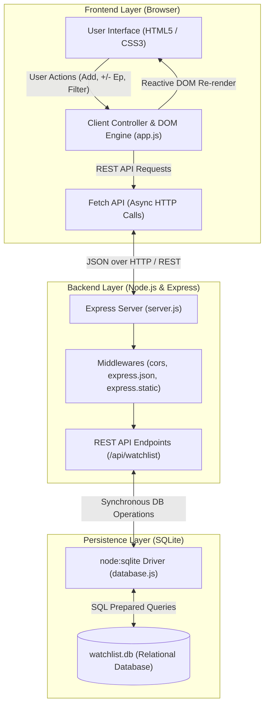
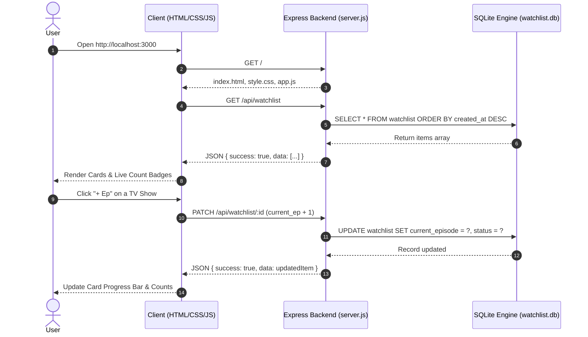

# 🎬 Next-Up: Movie & TV Show Watchlist Tracker

A sleek, dark-themed personal watchlist tracker where you can easily log movies and TV shows you want to watch next and track episode progress.

Built as a simple mini-project with **pure HTML, CSS, and Vanilla JavaScript** on the frontend and **Node.js with SQLite** on the backend.

---

## 🎯 Features

- **Simple & Sleek Dark UI**: Clean slate/charcoal dark theme. No clutter, no complex menus.
- **Log Movies & TV Shows**: Quick input form right at the top to add titles.
- **Episode Progress Tracking**: For TV shows, track your current episode (e.g. `Episode 4 / 10`) with `+` and `-` buttons that update in real time.
- **Status Pipeline**: Switch status anytime between **📌 Plan to Watch**, **🍿 Watching**, and **✅ Completed**.
- **Filter Tabs**: Instantly filter your list by *All*, *Movies*, *TV Shows*, *Watching*, or *Completed* with real-time count badges.
- **Delete Titles**: Remove items from your list anytime with 1 click.
- **Persistent Database**: Automatically saves your watchlist into SQLite (`watchlist.db`).

---

## 🏗️ System Architecture

The application follows a clean **3-Tier Client-Server Architecture**:



### 🔄 Data Flow Lifecycle



---

## 🚀 How to Run

1. Open PowerShell and navigate to the project directory:
   ```powershell
   cd "C:\Users\HP\OneDrive\Desktop\fsw"
   ```

2. Start the server:
   ```powershell
   node server.js
   ```

3. Open your browser:
   👉 **[http://localhost:3000](http://localhost:3000)**

---

## 📁 Project Structure

```
fsw/
├── public/                # 100% Pure HTML, CSS, JavaScript frontend
│   ├── index.html         # Clean, semantic layout (~80 lines)
│   ├── style.css          # Sleek dark theme styling (~170 lines)
│   └── app.js             # Vanilla JS for API calls & episode updates (~120 lines)
├── server.js              # Clean Node.js Express backend (~95 lines)
├── database.js            # SQLite database initialization
├── watchlist.db           # Persistent SQLite database file
├── package.json           # Dependencies (express, cors)
└── README.md
```
