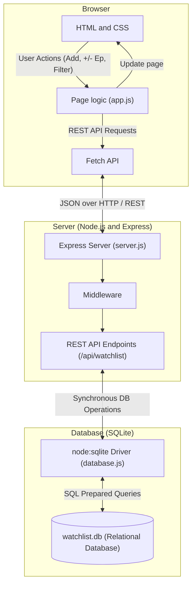
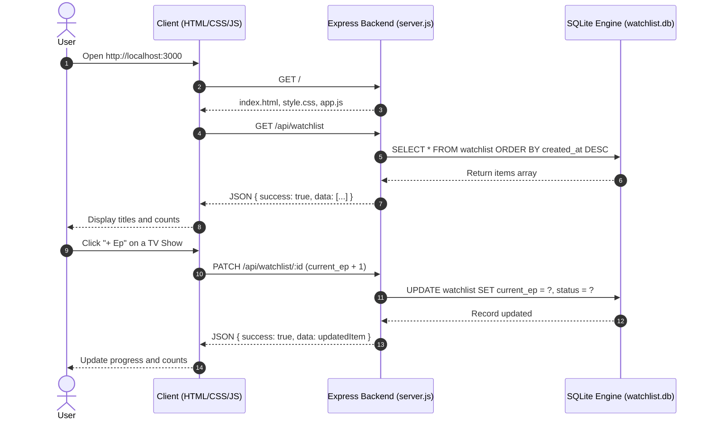

# Next-Up Watchlist

A movie and TV show watchlist built with HTML, CSS, JavaScript, Express, and SQLite.

## Setup

Install **Node.js 22.13.0 or newer**. The server uses the built-in `node:sqlite` module, which is unavailable in older Node.js versions. Check your version with `node --version`.

Clone the repository and install dependencies:

```sh
git clone https://github.com/smrsrh-cs/next-up-watchlist.git
cd next-up-watchlist
npm ci
npm start
```

If you already have the project, open a terminal in its folder and run `npm ci`, then `npm start`.

Open [http://localhost:3000](http://localhost:3000). If port 3000 is busy, the server tries the next port and prints the address. Keep the terminal running while using the app. Press Ctrl+C to stop it.

Use the server address to open the app; opening `public/index.html` directly will not connect to the API.

The server creates `watchlist.db` in the project folder on first startup and adds four sample titles. Your changes are saved between restarts. No API key, environment file, or separate database server is required.

## Features

- Add movies and TV shows.
- Track episodes with the + and - buttons.
- Set a title to Plan to Watch, Watching, or Completed.
- Filter by type or status and see the count in each category.
- Delete titles from the watchlist.

Completing a title sets its progress to the total episode count. Moving it to Plan resets progress to zero. Finishing a show's last episode marks it Completed; reducing its progress changes it back to Watching.

## Development

Restart the server automatically when server files change:

```sh
npm run dev
```

Run the backend tests:

```sh
npm test
```

Tests cover the API, input validation, static files, port fallback, and database persistence. They use a temporary database and leave your watchlist unchanged.

## Troubleshooting

- **Cannot find module 'express':** run `npm ci` in the project folder.
- **No such built-in module: node:sqlite:** install Node.js 22.13.0 or newer and reopen the terminal.
- **Page cannot connect:** check that `npm start` is still running and use the address printed in the terminal. Click Refresh watchlist after restarting the server.

## Project structure

```text
next-up-watchlist/
├── public/
│   ├── index.html          # Page layout
│   ├── style.css           # Styles
│   └── app.js              # UI events and API requests
├── test/
│   └── watchlist.test.js   # HTTP and persistence tests
├── server.js              # Express routes and server startup
├── database.js            # SQLite setup and sample data
├── watchlist.db            # Created on first run; ignored by Git
├── package.json
├── package-lock.json
└── README.md
```

## Architecture

The browser sends requests to the Express API. The API reads and writes the SQLite database and returns JSON.



### Request flow


